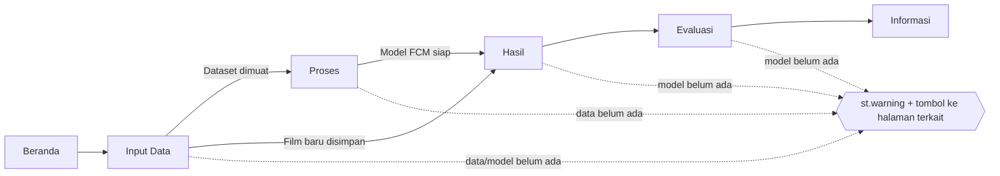

# Catatan GUI FuzzyFlix (Anggota 4: GUI & Visualisasi)

Dokumen ini menjelaskan struktur halaman, fungsi kontrak yang dipanggil tiap halaman, dan cara berpindah dari data demo ke data asli. Rujukan: `docs/PRD.md` (bagian 6 dan 8) dan `docs/design-system.md`.

## 1. Struktur file

```text
app.py                  # titik masuk + halaman Beranda (st.navigation)
pages/
├── 1_Input_Data.py     # F-03 s.d. F-07
├── 2_Proses.py         # F-08 s.d. F-13, F-25
├── 3_Hasil.py          # F-14 s.d. F-19, F-26
├── 4_Evaluasi.py       # F-20 s.d. F-22
└── 5_Informasi.py      # F-23, F-24
src/
├── plots.py            # semua grafik Plotly (fungsi murni, tanpa st.*)
├── provider.py         # SATU-SATUNYA tempat GUI memanggil modul anggota 1–3
├── demo_data.py        # pengganti sementara (data sintetis + algoritma ringkas)
├── interpret.py        # teks interpretasi, validasi input, pesan error, uraian jarak, prediksi rating
├── contoh.py           # contoh perhitungan FCM + KNN fuzzy (NumPy murni, dihitung live)
├── komponen.py         # komponen HTML/SVG: header, logo, kartu metrik, Film Pilihan, tabel rekomendasi, poster
├── tema.py             # blok CSS tema Cinematic Dark + CSS menu aktif
└── ui.py               # page_setup, sidebar (logo, menu, Status Sistem), banner demo, penjaga status
tests/                  # test_plots.py, test_gui_smoke.py (AppTest), test_contoh_dan_integrasi.py, test_komponen.py
```

Halaman memakai `st.navigation(..., position="hidden")` di `app.py`; menu digambar sendiri di `ui.sidebar_status()` dengan `st.page_link` (ikon material) supaya bisa bergaya pil merah. Judul menu: **Beranda · Input Data · Proses · Hasil Rekomendasi · Evaluasi · Informasi** (tanpa itu, Streamlit menamai halaman utama "app"). Jalankan selalu lewat `streamlit run app.py`.


## 1a. Tema tampilan (Cinematic Dark, mengikuti mockup Maytta)

Tema GUI mengikuti **mockup** yang dipilih Maytta: gelap sinematik dengan aksen merah, di semua halaman. Nilai ada di `.streamlit/config.toml`, CSS di `src/tema.py`, komponen HTML di `src/komponen.py`, dan palet/template grafik di `src/plots.py`. Versi Clean Light sebelumnya tersimpan di `fuzzyflix-styles/clean-light-applied/` (di luar zip).

| Token | Nilai Cinematic Dark |
|---|---|
| Tema dasar Streamlit | `base = "dark"` |
| `bg` (latar halaman) | `#0B0D12` |
| sidebar | `#10131A` dengan gelombang dan gulungan film merah samar di bawah |
| `surface` / kartu | `#151821`, border 1px `#262B38`, radius 12px |
| `primary` / aksen | `#E50914` (glow lembut, hover `#C40812`) |
| teks / teks redup | `#F5F5F7` / `#A0A6B1` |
| Hijau, biru, amber (kartu metrik) | `#22C55E`, `#3B82F6`, `#F59E0B` |
| Font | Inter (fallback Segoe UI, sans-serif) |
| Template Plotly | `plotly_dark`, latar transparan, grid `#232838` |
| Warna cluster C1–C8 | kembali ke palet awal: `#4C78A8`, `#F58518`, `#54A24B`, `#E45756`, `#72B7B2`, `#EECA3B`, `#B279A2`, `#9D755D` |
| Outline film acuan / rekomendasi | `#E50914` (rekomendasi), bintang putih (acuan) |
| Skala heatmap keanggotaan | `#151821` → `#1E3A8A` → `#3B82F6` → `#DBEAFE` |

Komponen khas mockup (semuanya di `src/komponen.py`): header halaman (ikon klaker merah, judul dua warna putih/merah, subjudul miring, hero kamera film dari SVG buatan sendiri), logo "FuzzyFlix", kartu *Status Sistem*, chip pengguna di kanan atas, callout *Ringkasan Hasil*, kartu *Film Pilihan* (poster, chip rating/tahun/durasi/genre, sinopsis, *Parameter Rekomendasi*), empat kartu metrik bergaris mini (Skor Kemiripan Tertinggi, FPC, Silhouette, Precision@10), tabel *Daftar Rekomendasi* dengan bar skor merah dan tombol *Lihat Semua →*, serta dua kartu grafik (*Visualisasi Cluster*, *Fungsi Objektif FCM*).

**Poster dan sinopsis.** Bila CSV memuat kolom opsional `poster_path` dan `overview` (The Movies Dataset memilikinya), kartu memakai `https://image.tmdb.org/t/p/w185{poster_path}` yang dimuat browser; bila kosong, offline, atau mode demo, tampil poster pengganti (gradien gelap + inisial judul). Kolom ini hanya untuk tampilan, tidak dipakai model, dan tidak ada panggilan jaringan dari Python (tes berjalan offline).

**Keterbatasan Streamlit yang disiasati.**
- `st.html` membuang tag `<svg>`; semua ikon dan grafik mini dipasang sebagai gambar data-URI lewat CSS (`mask-image` / `background-image`).
- Menu bawaan tidak bisa diberi gaya halaman aktif; menu dibuat ulang dengan `st.page_link` dan pil merah dipasang lewat CSS per halaman (`tema.css_menu_aktif`).
- Chip pengguna dan ikon bulan adalah elemen `position: fixed` (tidak interaktif); hero bukan gambar penuh, melainkan ilustrasi SVG.
- Tabel `st.dataframe` (canvas) hanya bisa diberi tema lewat konfigurasi; Daftar Rekomendasi memakai tabel HTML sendiri, tabel lengkap tetap `st.dataframe` untuk pengurutan dan CSV.
- Selektor CSS memakai `data-testid` Streamlit 1.67; periksa `src/tema.py` bila versi Streamlit naik.

**Perubahan yang perlu dicatat di `docs/design-system.md`:** bagian 2 (warna dasar: `#0B0D12`, `#151821`, `#E50914`; cluster kembali ke 8 warna awal), bagian 3 (font Inter), bagian 4.1 (sidebar: logo, menu ikon dengan pil merah, kartu Status Sistem, tagline), bagian 4.x (judul halaman berupa HTML `h1` dua warna, bukan `st.title`), bagian 5 (kartu metrik HTML bergaris mini menggantikan `st.metric` di halaman Hasil), bagian 6.1 (template `plotly_dark`, skala heatmap gelap).

## 2. Alur navigasi (untuk flowchart BAB III)



## 3. Halaman, isi, dan fungsi kontrak yang dipanggil

Semua panggilan melewati `src/provider.py`. Kolom "Modul asli" adalah fungsi kontrak PRD bagian 8.

| Halaman | Isi | Modul asli yang dipanggil | Grafik (`plots.py`) |
|---|---|---|---|
| **Beranda** | judul, deskripsi, tujuan, kombinasi metode FCM + KNN beserta rumus integrasi, 3 kartu alur, tombol Mulai, status | – | – |
| **Input Data** | sumber data (bawaan/unggah), validasi CSV, form film baru, tabel variabel, preview 10 baris | `preprocessing.load_and_clean`, `build_features`, `validate_csv`, `transform_new`; `fcm.membership` | `plot_query_membership` |
| **Proses** | 4 tahap, form c/m/ε/maxiter, tombol Jalankan Clustering, tabel parameter yang dipakai, metrik, J_m, FPC/silhouette per c, **fungsi keanggotaan FCM**, **hasil antara per iterasi (U, V, perpindahan pusat)**, heatmap, rumus | `fcm.fcm` (juga dipanggil ulang dengan `maxiter = k` untuk hasil antara), `fcm.select_c`, `fcm.membership` | `plot_objective`, `plot_select_c`, `plot_membership_function`, `plot_membership_curve`, `plot_center_trajectory`, `plot_membership_heatmap`, `plot_pca_variance` |
| **Hasil** | film acuan + k + α, kartu film, interpretasi, tabel, **uraian integrasi FCM → KNN** (uraian jarak, vektor u, beda dengan KNN biasa, perbandingan rating), scatter, bar, radar, unduh CSV | `knn_fuzzy.recommend` (dua kali: α dan α = 1), `fcm.membership` untuk film baru | `plot_distance_breakdown`, `plot_membership_compare`, `plot_rating_comparison`, `plot_clusters`, `plot_query_membership`, `plot_cluster_radar` |
| **Evaluasi** | skenario pengujian, tombol Jalankan Pengujian, FPC/silhouette/Precision@K, **RMSE/MAE + grafik rating aktual vs prediksi**, **sapuan α**, kualitas cluster, interpretasi, kelebihan/keterbatasan | `evaluation.precision_at_k`, `knn_fuzzy.recommend` | `plot_precision`, `plot_actual_vs_pred`, `plot_alpha_sweep`, `plot_cluster_quality` |
| **Informasi** | 5 tab: Metode & Integrasi (kartu input-parameter-rumus-proses-keluaran), Library & Kode (tabel library + lokasi kode live), Contoh Perhitungan (live), Arsitektur & Alur, Petunjuk & Anggota | `inspect` pada fungsi kontrak; `fcm.membership` (pemeriksaan contoh) | `arsitektur_dot`, `alur_algoritma_dot`, `plot_contoh_fcm` |

Yang dihitung di sisi GUI (bukan kontrak): nama cluster (`interpret.name_clusters`), profil radar (`cluster_profile`), silhouette total dan per cluster (scikit-learn, sampel ≤ 3.000 film), proyeksi PCA 2D bila `artefak` tidak memuatnya, uraian jarak integrasi (`interpret.rincian_jarak`), RMSE/MAE prediksi rating, dan sapuan α.

`st.session_state` yang dipakai: `df_film`, `X`, `artefak`, `fcm_result`, `last_reco` (sesuai design-system bagian 9) ditambah `new_film`, `film_view`, `nama_cluster`, `fcm_param`, `select_c_df`, `eval_hasil`, `data_mode`, `bagian_demo`.

## 4. Cara kerja mode demo dan cara beralih ke data asli

`provider.py` memanggil modul asli lebih dulu:

1. **Saat aplikasi dibuka**: jika kelima file `models/X.npy, U.npy, V.npy, artefak.joblib, film.parquet` ada, semuanya dimuat dan aplikasi langsung memakainya (mode *real*). Jika tidak, dimuat dataset demo 1.200 film sintetis dengan model FCM demo (c = 5) supaya semua halaman bisa dicoba.
2. **Tiap fungsi kontrak** dipanggil dari `src/<modul>.py`. Jika modul belum ada atau fungsinya melempar `NotImplementedError`, otomatis dipakai fungsi bernama sama di `src/demo_data.py`, dan banner `st.info` di setiap halaman menyebut bagian mana yang masih demo.
3. Banner demo hilang sendiri ketika semua bagian sudah asli. **Tidak ada kode GUI yang perlu diubah.**

Langkah beralih ke data asli:

1. Anggota 1–3 mengisi fungsi di `preprocessing.py`, `fcm.py`, `knn_fuzzy.py`, `evaluation.py` sesuai signature PRD bagian 8.
2. Taruh `movies_metadata.csv` di `data/raw/`, jalankan skrip training agar `models/` terisi (atau di GUI: Input Data → Pakai Dataset Bawaan → Proses → Jalankan Clustering).
3. Buka ulang `streamlit run app.py`. Sidebar menampilkan "Data dimuat" tanpa label Mode demo.
4. Opsional: hapus `src/demo_data.py` setelah semua fungsi asli selesai (provider tetap jalan; ganti baris fallback bila ingin menolak demo).

Tombol **Kembali ke Data Demo** di Input Data memuat ulang data demo kapan saja.

## 5. Asumsi tentang bentuk data (PRD tidak menyebut rinci)

| Hal | Asumsi GUI | Dimana disesuaikan |
|---|---|---|
| Kolom `genres` di `df_film` | list, string JSON dataset Kaggle, atau string dipisah `\|`/`,` (semua diterima) | `interpret.parse_genres` |
| Tahun di `df_film` | kolom `year`, atau diturunkan dari `release_date` | `interpret.film_year` |
| Kolom hasil `precision_at_k` | `k, precision_fuzzy, precision_baseline` (alias `fuzzy`, `baseline`, dst. diterima) | `plots.normalisasi_tabel_precision` |
| Urutan kolom `X` | 5 fitur numerik dulu (rating, vote, popularitas, durasi, tahun), lalu PC genre; nama diambil dari `artefak['feature_names']` bila ada | `provider.nama_fitur` |
| PCA 2D untuk scatter | `artefak['pca_2d']` berupa objek PCA (punya `.transform`). Jika bukan, GUI memasang `PCA(2)` pada `X` | `provider._model_2d` |
| Isi dict film baru untuk `transform_new` | `title, vote_average, vote_count, popularity, runtime, year, release_date, genres(list)` | `provider._kunci_film_baru` |
| `J_history` saat model dimuat dari `models/` | tidak tersimpan → grafik J_m kosong sampai Jalankan Clustering dipakai | – |
| `fcm_result['fpc']` bila hanya `U` tersedia | dihitung `Σu²/n` | `provider.init_session` |
| c > 8 | warna cluster diulang (modulo 8) | `plots.cluster_color` |
| Hasil antara FCM | `fcm.fcm(..., maxiter=k, seed=42)` dipanggil ulang untuk k = 1, 2, 3, 5, 10 dan diasumsikan deterministik (sama dengan k iterasi pertama proses penuh) | `provider.hitung_hasil_antara` |
| Prediksi rating (RMSE/MAE) | rating film acuan = rata-rata `vote_average` k = 10 tetangga berbobot skor; bukan rating per pengguna `ratings_small.csv` | `provider._prediksi_cached` |
| Lokasi kode (tab Library & Kode) | fungsi dianggap asli jika sumbernya tidak mengandung `NotImplementedError` | `provider.lokasi_kode` |

## 6. Pesan error GUI

Semua pesan mengikuti pola **apa yang salah + cara memperbaiki** (design-system 5.3). Sumbernya di `interpret.py`: `validasi_csv_cadangan`, `validasi_film_manual`, `validasi_parameter`, `pesan_error_ramah`. Exception tak terduga ditampilkan sebagai `st.error` ramah dan detail teknis disembunyikan dalam expander.

## 7. Menjalankan tes

```bash
pip install -r requirements.txt
pytest
streamlit run app.py
```


## 8. Checklist: ketentuan tugas (Dr. Made Agung Raharja) → lokasi di aplikasi

Daftar celah yang ditemukan saat audit dan perbaikannya ada di bagian 9.

| Butir | Ketentuan | Lokasi di aplikasi |
|---|---|---|
| **E1** Halaman Utama | nama & deskripsi, tujuan, navigasi | Beranda (`app.py`): judul, deskripsi, tujuan, kombinasi metode, alur; navigasi sidebar `st.navigation` |
| **E2** Input Data | input manual, unggah, validasi, penjelasan variabel | Input Data: form film baru (manual), uploader CSV, validasi + `st.error`, tabel "Penjelasan variabel"; Informasi › Contoh Perhitungan juga menerima data manual |
| **E3** Proses | tombol jalankan, tahapan, parameter, hasil antara | Proses: tombol Jalankan Clustering, 4 tahapan, form + tabel "Parameter yang digunakan", J_m, **Hasil antara per iterasi** (U, V, perpindahan pusat), fungsi keanggotaan, heatmap |
| **E4** Hasil | hasil akhir, tabel, grafik, interpretasi | Hasil: tabel rekomendasi, kartu film, interpretasi otomatis, scatter, bar, radar, **uraian integrasi FCM → KNN**, perbandingan rating |
| **E5** Evaluasi | pengujian, metrik, kualitas & keterbatasan | Evaluasi: skenario, FPC, silhouette, Precision@K, **RMSE/MAE**, grafik **aktual vs prediksi**, **sapuan α**, kelebihan/keterbatasan |
| **E6** Informasi Sistem | metode, variabel, parameter, algoritma, petunjuk | Informasi: tab Metode & Integrasi, Library & Kode, Contoh Perhitungan, Arsitektur & Alur, Petunjuk & Anggota |
| **F1** library dijelaskan | fungsi tiap library | Informasi › Library & Kode: tabel library, fungsi, API utama, tempat dipakai |
| **F2** metode bertahap | proses kerja bertahap | Proses (4 tahap) dan Informasi › Metode, Contoh Perhitungan, Flowchart algoritma |
| **F3/F4** input, parameter, rumus, iterasi, output | per metode | Informasi › Metode: kartu FCM, KNN fuzzy, PCA, Evaluasi (Input/Parameter/Rumus/Proses/Keluaran) |
| **F5** menunjuk kode | bagian kode algoritma utama | Informasi › Library & Kode: tabel lokasi kode (file + baris) dan tampilan kode fungsi (live) |
| **F6** API library siap pakai | fungsi utama dan komputasinya | Informasi › Library & Kode: expander "Apa yang dihitung di dalam `skfuzzy.cmeans` dan scikit-learn?" |
| **F7** contoh perhitungan sederhana | contoh hitung | Informasi › Contoh Perhitungan: FCM 5 film × 2 fitur × 2 cluster (pusat, jarak, U, J_m, Δ per iterasi), lalu jarak KNN fuzzy satu pasangan; dihitung live dan dicek terhadap `fcm.membership` |
| **G** GUI | rapi, konsisten, navigasi, tombol, hasil informatif, visualisasi, error, tanpa ubah kode | `src/ui.py` (set_page_config, tema, sidebar status), satu tombol utama per halaman, pesan error di `interpret.py`, grafik di `plots.py` |
| **G** visual: fungsi keanggotaan | grafik fungsi keanggotaan | Proses › "Fungsi keanggotaan FCM" (eksak + rata-rata data) |
| **G** visual: cluster & pusat | scatter, pusat cluster | Hasil › Peta cluster; Proses › perpindahan pusat cluster |
| **G** visual: arsitektur (pengganti ANFIS) | diagram | Informasi › Arsitektur & Alur (arsitektur + flowchart) |
| **G** visual: training & loss | grafik loss | Proses › grafik J_m per iterasi |
| **G** visual: aktual vs prediksi | grafik aktual vs sistem | Evaluasi › Rating aktual vs prediksi sistem; Hasil › perbandingan rating |
| **G** visual: evaluasi | grafik pengujian | Evaluasi › Precision@K, sapuan α, kualitas cluster |
| **D** integrasi eksplisit | FCM dan KNN terintegrasi | Beranda (rumus), Proses (catatan keluaran U/V dipakai KNN), Hasil › Integrasi FCM → KNN (uraian jarak, vektor u, selisih dengan KNN biasa), Informasi › Metode |
| **N/A** ANFIS / training NN | tidak dipakai | diganti diagram arsitektur dan grafik J_m |

## 9. Hasil audit: celah dan perbaikan

| Celah (sebelum) | Perbaikan |
|---|---|
| Tidak ada hasil antara iterasi (hanya hasil akhir) | Proses: snapshot U, V, J pada iterasi 1, 2, 3, 5, 10 dan akhir + grafik perpindahan pusat |
| Parameter hanya terlihat di form | Proses: tabel "Parameter yang digunakan" dengan nilai dan arti |
| Fungsi keanggotaan hanya rata-rata empiris di sudut halaman | Bagian tersendiri berisi kurva eksak (`fcm.membership`) dan kurva empiris |
| Integrasi FCM → KNN hanya disebut di teks | Hasil: uraian jarak (fitur vs keanggotaan), heatmap vektor u, perbandingan dengan KNN biasa, contoh angka |
| Tidak ada grafik aktual vs prediksi dan tidak ada RMSE/MAE | Evaluasi: prediksi rating dari tetangga, RMSE/MAE, scatter aktual vs prediksi, sapuan α |
| Tidak ada contoh perhitungan | Informasi › Contoh Perhitungan (live, dapat diedit) |
| Tidak ada tabel library/API dan penunjuk kode | Informasi › Library & Kode |
| Penjelasan metode tidak per kartu input-parameter-rumus-proses-output | Informasi › Metode & Integrasi |
| Beranda tidak menyebut kombinasi metode | Beranda: bagian "Kombinasi metode" |
| Tabel kontribusi tidak sesuai format tugas | Informasi › Petunjuk & Anggota: No, Nama/NIM, Tanggung jawab, Kontribusi konkret, Bukti |
| Dataset unggahan terlalu kecil setelah dibersihkan → pesan generik | `_cek_jumlah`: pesan jelas (minimal 20 film) |
