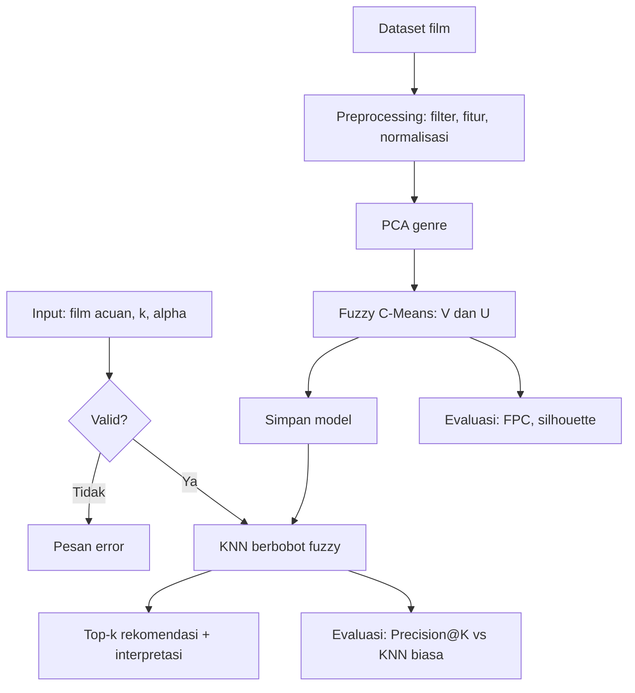

# PRD – FuzzyFlix: Rekomendasi Film Berbasis Fuzzy C-Means + KNN

> Final Project Teknologi Logika Fuzzy · Kelompok 4 orang
> Status: Draft v1 (21 Nov 2026). Label **[Diputuskan]** = sudah disepakati, **[Usulan]** = masih bisa diubah tim.

---

## 1. Ringkasan

FuzzyFlix adalah aplikasi Python ber-GUI yang merekomendasikan film serupa dari sebuah film acuan. Sistem mengelompokkan film dengan **Fuzzy C-Means (FCM)** sehingga setiap film punya derajat keanggotaan ke beberapa cluster, lalu **K-Nearest Neighbor (KNN)** memakai derajat keanggotaan itu di dalam rumus jaraknya untuk mencari film paling mirip.

| Item | Keterangan |
|---|---|
| Metode fuzzy | Fuzzy C-Means **[Diputuskan]** |
| Metode pendukung | KNN berbobot keanggotaan, dibantu PCA **[Diputuskan]** |
| Integrasi | Vektor keanggotaan FCM masuk langsung ke rumus jarak KNN **[Diputuskan]** |
| Dataset | The Movies Dataset (Kaggle), `movies_metadata.csv` + `ratings_small.csv` **[Diputuskan]** |
| Bahasa | Python 3.10+ **[Diputuskan]** |
| GUI | Streamlit **[Usulan]** (alternatif: CustomTkinter) |
| Metrik | FPC, silhouette score, Precision@K **[Diputuskan]** |

> ⚠️ Dataset sama dengan proyek Sains Data. Topik harus dikonfirmasi ke dosen sebelum implementasi.

---

## 2. Latar Belakang dan Masalah

Katalog film sangat besar sehingga pengguna sulit menemukan film yang mirip dengan film yang mereka sukai. Banyak film punya ciri campuran (misalnya action + komedi + sci-fi). Clustering keras seperti K-Means memaksa setiap film masuk satu kelompok sehingga ciri campuran hilang. FCM memberi derajat keanggotaan 0–1 ke setiap cluster, sehingga ciri campuran tetap tercatat dan bisa dipakai KNN untuk mengukur kemiripan dengan lebih halus.

### Rumusan masalah
1. Bagaimana mengelompokkan film secara fuzzy berdasarkan rating, popularitas, durasi, tahun, dan genre?
2. Bagaimana memakai derajat keanggotaan FCM untuk meningkatkan rekomendasi KNN?
3. Seberapa baik kualitas cluster dan rekomendasi dibanding KNN tanpa fuzzy?

### Tujuan
- Membangun aplikasi GUI yang memberi rekomendasi film beserta penjelasan proses fuzzy-nya.
- Membuktikan secara terukur kontribusi FCM terhadap kualitas rekomendasi.

### Batasan masalah
- Hanya film dengan `vote_count` ≥ 50, `runtime` > 0, punya tanggal rilis dan genre (**9.089 film, 20 genre**).
- Fitur hanya numerik + genre; isi cerita (overview) tidak dipakai untuk perhitungan.
- Tidak ada login, akun, atau database; aplikasi berjalan lokal.

---

## 3. Pengguna

| Pengguna | Kebutuhan |
|---|---|
| Penonton umum | Pilih film, dapat rekomendasi cepat tanpa paham algoritma |
| Dosen/penguji | Melihat proses FCM, parameter, hasil antara, dan evaluasi saat demo |

---

## 4. Dataset dan Variabel

Sumber: `movies_metadata.csv` (45.466 film mentah) dan `ratings_small.csv` (100.004 rating, 671 pengguna, opsional untuk evaluasi).

| Variabel | Kolom asal | Perlakuan |
|---|---|---|
| Rating | `vote_average` | Min-max 0–1 |
| Jumlah vote | `vote_count` | log1p → min-max |
| Popularitas | `popularity` | log1p → min-max |
| Durasi | `runtime` | Min-max |
| Tahun rilis | `release_date` | Ambil tahun → min-max |
| Genre | `genres` (string JSON) | One-hot 20 kolom → PCA (~80% variansi) |
| Judul, overview, id | `title`, `overview`, `id` | Hanya untuk tampilan |

Kolom wajib untuk CSV unggahan: `id, title, vote_average, vote_count, popularity, runtime, release_date, genres`.

---

## 5. Alur Sistem



### 5.1 Preprocessing
1. Ubah kolom angka dari teks, buang baris rusak dan duplikat `id`.
2. Filter sesuai batasan masalah.
3. Ekstrak tahun, parse genre jadi one-hot, log1p untuk vote dan popularitas.
4. Min-max semua fitur numerik.
5. PCA pada 20 kolom genre.
6. Gabungkan → matriks `X` (n_film × n_fitur). Simpan juga PCA 2D seluruh `X` untuk scatter plot.

### 5.2 Fuzzy C-Means

| Parameter | Default | Rentang di GUI |
|---|---|---|
| `c` (jumlah cluster) | dipilih otomatis | 2–10 |
| `m` (fuzzifier) | 2.0 | 1.1–3.0 |
| `error` (ε) | 1e-5 | 1e-6–1e-3 |
| `maxiter` | 300 | 50–1000 |
| `seed` | 42 | tetap |

Rumus:
- Pusat cluster: `v_j = Σ_i (u_ij^m · x_i) / Σ_i u_ij^m`
- Keanggotaan: `u_ij = 1 / Σ_k (d_ij / d_ik)^(2/(m−1))`
- Fungsi objektif: `J_m = Σ_i Σ_j u_ij^m · d_ij²`
- Berhenti jika `max|U_baru − U_lama| < ε` atau iterasi = `maxiter`.

Pemilihan `c`: jalankan c = 3…8, pilih kombinasi FPC dan silhouette terbaik. Setiap cluster diberi nama dari ciri pusatnya (genre dominan, rata-rata rating, tahun).

### 5.3 KNN berbobot fuzzy
`d(q, i) = α · ‖x_q − x_i‖ + (1 − α) · ‖u_q − u_i‖`

- `α` default 0.5 (α = 1 berarti KNN biasa, dipakai sebagai baseline).
- Film acuan dikeluarkan dari hasil. Skor kemiripan = `1 / (1 + d)`.
- Film baru dari input manual: hitung `u` dengan rumus keanggotaan memakai `V` tersimpan.

### 5.4 Evaluasi
| Metrik | Mengukur | Target |
|---|---|---|
| FPC | Ketegasan partisi fuzzy | Mendekati 1 |
| Silhouette | Kerapian cluster (berdasarkan cluster dominan) | > 0.25 **[Usulan]** |
| J_m per iterasi | Konvergensi | Turun lalu stabil |
| Precision@5/10/20 | Rekomendasi relevan | Fuzzy ≥ KNN biasa |

Protokol: 200 film acuan acak (seed 42). Relevan = berbagi ≥1 genre dengan film acuan. Versi lanjutan **[Usulan]**: relevan jika diberi rating ≥ 4 oleh pengguna yang memberi rating ≥ 4 ke film acuan di `ratings_small.csv` (dipetakan lewat `links.csv`).

---

## 6. Kebutuhan Fungsional

Prioritas: **P0** wajib (ketentuan dosen), **P1** penting, **P2** tambahan.

| ID | Halaman | Fitur | Prioritas |
|---|---|---|---|
| F-01 | Beranda | Nama, deskripsi, tujuan sistem | P0 |
| F-02 | Semua | Navigasi menu ke 6 halaman | P0 |
| F-03 | Input Data | Pakai dataset bawaan | P0 |
| F-04 | Input Data | Unggah CSV + cek kolom wajib dan tipe data | P0 |
| F-05 | Input Data | Input manual film baru (rating, vote, popularitas, durasi, tahun, genre) | P0 |
| F-06 | Input Data | Penjelasan setiap variabel | P0 |
| F-07 | Input Data | Pesan error untuk input tidak valid | P0 |
| F-08 | Proses | Atur parameter c, m, ε, maxiter | P0 |
| F-09 | Proses | Tombol "Jalankan Clustering" | P0 |
| F-10 | Proses | Penjelasan tahapan proses | P0 |
| F-11 | Proses | Grafik J_m per iterasi | P0 |
| F-12 | Proses | Grafik FPC & silhouette per c | P0 |
| F-13 | Proses | Heatmap matriks keanggotaan (sampel) | P1 |
| F-14 | Hasil | Pilih film acuan (search), k, α + tombol "Cari Rekomendasi" | P0 |
| F-15 | Hasil | Tabel rekomendasi (judul, genre, rating, skor, cluster dominan) | P0 |
| F-16 | Hasil | Scatter plot cluster 2D + pusat cluster + film acuan + rekomendasi | P0 |
| F-17 | Hasil | Bar chart keanggotaan film acuan | P0 |
| F-18 | Hasil | Interpretasi otomatis dalam kalimat | P0 |
| F-19 | Hasil | Radar chart ciri pusat cluster | P1 |
| F-20 | Evaluasi | Tombol "Jalankan Pengujian" + tabel metrik | P0 |
| F-21 | Evaluasi | Grafik Precision@K fuzzy vs KNN biasa | P0 |
| F-22 | Evaluasi | Penjelasan kualitas dan keterbatasan | P0 |
| F-23 | Informasi | Penjelasan metode, rumus, parameter, petunjuk penggunaan | P0 |
| F-24 | Informasi | Diagram arsitektur sistem | P1 |
| F-25 | Proses | Kurva keanggotaan terhadap satu fitur | P2 |
| F-26 | Hasil | Unduh hasil rekomendasi sebagai CSV | P2 |

## 7. Kebutuhan Non-Fungsional
- Rekomendasi tampil < 2 detik setelah tombol ditekan (model sudah tersimpan).
- Clustering ulang 9 ribu film < 30 detik.
- Hasil bisa diulang (seed terkunci).
- Bisa dijalankan dengan `pip install -r requirements.txt` lalu `streamlit run app.py`.
- Tidak perlu membuka atau mengubah kode untuk memakai aplikasi.

---

## 8. Kontrak Antarmodul **[Diputuskan]**

Semua anggota wajib mengikuti signature ini supaya modul bisa disambung tanpa bentrok.

```python
# src/preprocessing.py
def load_and_clean(path: str) -> pd.DataFrame: ...
def build_features(df: pd.DataFrame) -> tuple[np.ndarray, pd.DataFrame, dict]:
    """return X (n, f), df_film (id, title, genres, vote_average, ...), artefak {scaler, pca}"""
def validate_csv(df: pd.DataFrame) -> list[str]:
    """return daftar pesan error; list kosong = valid"""
def transform_new(film: dict, artefak: dict) -> np.ndarray: ...

# src/fcm.py
def fcm(X: np.ndarray, c: int, m: float = 2.0, error: float = 1e-5,
        maxiter: int = 300, seed: int = 42) -> dict:
    """return {'V': (c, f), 'U': (n, c), 'J_history': list[float], 'n_iter': int, 'fpc': float}"""
def membership(x: np.ndarray, V: np.ndarray, m: float = 2.0) -> np.ndarray: ...
def select_c(X, c_range=range(3, 9), **kw) -> pd.DataFrame:
    """kolom: c, fpc, silhouette"""

# src/knn_fuzzy.py
def recommend(q_idx: int | None, X, U, k: int = 10, alpha: float = 0.5,
              x_new=None, u_new=None) -> pd.DataFrame:
    """kolom: idx, distance, score"""

# src/evaluation.py
def precision_at_k(X, U, df_film, k_list=(5, 10, 20), n_sample=200,
                   alpha=0.5, seed=42) -> pd.DataFrame: ...

# src/plots.py  -> semua fungsi return figure Plotly/Matplotlib, tidak memanggil st.*
```

Artefak tersimpan di `models/`: `X.npy`, `U.npy`, `V.npy`, `artefak.joblib`, `film.parquet`.

---

## 9. Struktur Folder

```text
fuzzyflix/
├── app.py
├── pages/
│   ├── 1_Input_Data.py
│   ├── 2_Proses.py
│   ├── 3_Hasil.py
│   ├── 4_Evaluasi.py
│   └── 5_Informasi.py
├── src/
│   ├── preprocessing.py
│   ├── fcm.py
│   ├── knn_fuzzy.py
│   ├── evaluation.py
│   └── plots.py
├── data/        # CSV mentah (tidak di-commit, lihat README)
├── models/      # artefak hasil training
├── notebooks/   # EDA, eksperimen, contoh hitung manual
├── tests/
├── docs/        # PRD.md, design-system.md
├── requirements.txt
└── README.md
```

## 10. Library

| Library | Fungsi |
|---|---|
| pandas, NumPy | Olah data, operasi matriks |
| NumPy (implementasi mandiri) + scikit-fuzzy | FCM; `skfuzzy.cmeans` sebagai pembanding hasil |
| scikit-learn | MinMaxScaler, PCA, NearestNeighbors, silhouette_score |
| Plotly, Matplotlib | Visualisasi |
| Streamlit | GUI |
| joblib, pyarrow | Simpan artefak |

---

## 11. Pembagian Peran

| Anggota | Peran | Modul | Bagian laporan |
|---|---|---|---|
| 1 | Data & Preprocessing | `preprocessing.py`, EDA, validasi CSV | BAB I, BAB III (dataset, variabel) |
| 2 | Fuzzy C-Means | `fcm.py`, pemilihan c, contoh hitung FCM | BAB II (fuzzy, FCM), BAB IV (FCM) |
| 3 | KNN, Integrasi, Evaluasi | `knn_fuzzy.py`, `evaluation.py`, contoh hitung KNN | BAB II (KNN, integrasi), BAB III (pengujian), BAB IV (hasil uji) |
| 4 | GUI & Visualisasi | `app.py`, `pages/`, `plots.py` | BAB III (GUI, flowchart), BAB IV (tampilan), lampiran manual |

Bersama: BAB V, daftar pustaka, slide, tabel kontribusi. Setiap anggota wajib paham seluruh sistem.

## 12. Jadwal **[Usulan]**

| Minggu | Fase | Output |
|---|---|---|
| 1 | Persiapan + data | Repo, konfirmasi dosen, data bersih & `X` |
| 2 | Algoritma inti | FCM jalan, kerangka GUI dengan data dummy |
| 3 | KNN + integrasi | Rekomendasi tersambung ke GUI |
| 4 | Evaluasi + uji | Metrik, grafik, validasi input, README |
| 5 | Laporan + presentasi | Laporan BAB I–V, slide, latihan demo |

Ketergantungan: Anggota 2 & 3 butuh `X` dari Anggota 1 paling lambat akhir minggu 1. Anggota 4 mulai dengan data dummy.

## 13. Konvensi Git
- Branch: `data`, `fcm`, `knn-eval`, `gui`; merge ke `main` lewat Pull Request yang di-review minimal 1 anggota lain.
- Commit kecil dan jelas, contoh: `feat(fcm): update keanggotaan`, `fix(gui): validasi k`.
- Jangan commit file CSV besar dan `models/*.npy`.

## 14. Risiko dan Keterbatasan
| Risiko | Mitigasi |
|---|---|
| Dosen menolak dataset yang sama dengan Sains Data | Konfirmasi di minggu 1; cadangan: ide ANFIS prediksi rating |
| Hasil FCM berubah tiap run | Kunci seed |
| Silhouette rendah karena data padat | Coba variasi fitur/PCA, laporkan jujur sebagai keterbatasan |
| Relevansi berbasis genre terlalu sederhana | Tambah evaluasi berbasis `ratings_small` |

## 15. Pertanyaan Terbuka
- Streamlit atau CustomTkinter?
- Nama aplikasi final?
- Pakai evaluasi berbasis `ratings_small` atau cukup genre?
